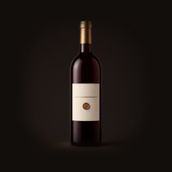
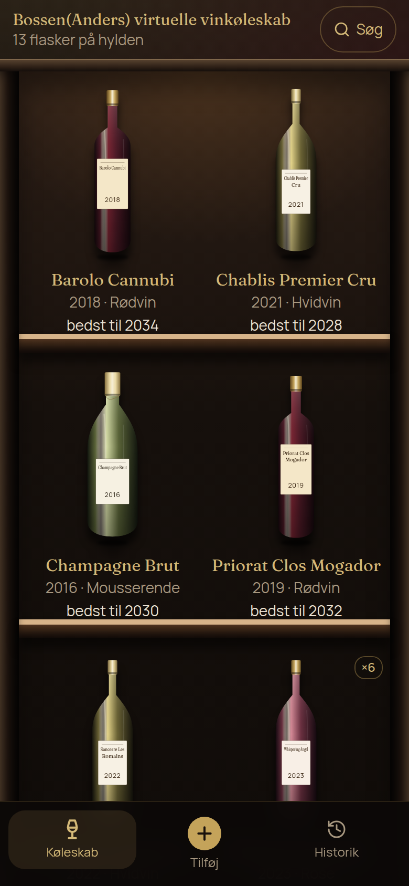

<p align="center">
  
</p>

# Winefridge


**Bossen(Anders) virtuelle vinkøleskab.** A phone-first cabinet for one person's bottles: photograph a label, keep the inventory on this device, and see when a bottle is ready to drink.

**Public site:** [winefridge.gundelach.pw](https://winefridge.gundelach.pw)

<p align="center">
  
</p>

---

## What it does

| View | Purpose |
| :--- | :--- |
| **Køleskab** | The open cabinet. Two bottles sit on each shelf, with name, vintage, type and a short drinking window. Search and type filters stay behind **Søg** until they are needed. |
| **Tilføj** | Photograph a label or search the [WineAPI](https://wineapi.io/) catalogue. Name, vintage, type and count are enough to save. Producer, place, grapes, dates and notes sit under **Flere detaljer**. |
| **Flaske** | One bottle's details. **Tag ud** asks for confirmation and can take part of a case. |
| **Historik** | Bottles that have left the cabinet. |

The first visit in a browser seeds a few example bottles. They live only in that browser.

Wine types are rød, hvid, rosé, mousserende, portvin, madeira, sherry, dessert, orange and anden. The drawn bottle follows the type. A saved label photo replaces the printed name on the bottle.

## On the phone

The app is meant to be added to an iPhone Home Screen or an Android home screen. [`public/manifest.webmanifest`](public/manifest.webmanifest) uses `display: standalone`, portrait orientation and the dark theme colour `#120e0b`. The home-screen image is an opaque bottle on that same dark ground: 180×180 for Apple, 192×192 and 512×512 for the manifest, plus a maskable 512×512 with the bottle inside the safe area. Apple web-app metadata in [`src/app/layout.tsx`](src/app/layout.tsx) points at the same Apple icon, and `src/app/favicon.ico` is the browser tab icon. Adding it to a physical iPhone has not been checked.

There is no service worker. Opening the installed icon still needs the site to load. Bottles already saved in this browser remain in `localStorage` and show up again once the page can load.

## Where the bottles live

The cabinet is stored in this browser under `winefridge.bottles.v1`. There is no account and no sync. Clearing the site data, or opening the app in another browser, starts a separate cabinet. Label photos are compressed and kept in the same record.

WineAPI is optional. Without `WINEAPI_API_KEY`, catalogue search and photo recognition return no suggestion, and a bottle can still be typed in by hand. The key is read on the server. It is not sent to the browser.

## Stack

[Next.js 16](https://nextjs.org/) App Router, [React 19](https://react.dev/), TypeScript and [Tailwind CSS 4](https://tailwindcss.com/). The interface uses shadcn/ui, Radix primitives, Lucide icons, and the Fraunces and Manrope fonts.

## Run locally

```bash
npm install
cp .env.example .env.local
npm run dev
```

A personal key from [wineapi.io](https://wineapi.io/) goes in `.env.local` when recognition and catalogue search should work:

```bash
WINEAPI_API_KEY=wapi_your_key_here
```

The repository has no lockfile, so the install command is `npm install`.

| Check | Command |
| :--- | :--- |
| Production build | `npm run build` |
| Serve that build | `npm run start` |
| Lint | `npm run lint` |
| Shelf and label tests | `npm test` |

`npm test` covers how bottles are grouped on a shelf, the short drinking-window line, and that a label only repeats the wine's own name and year.
